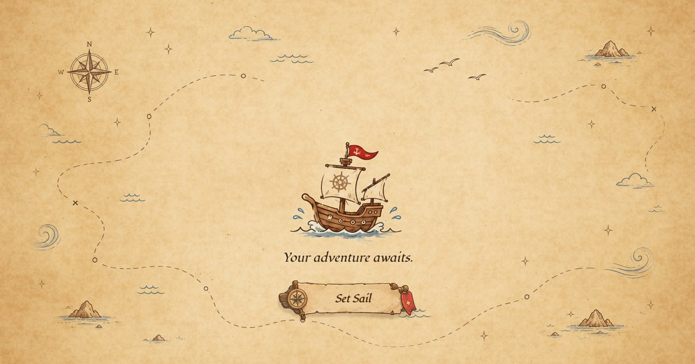

# Wenz Louie Rejas — Interactive 3D Portfolio

[](https://wenzrejas.github.io/)

<p align="center"><a href="https://wenzrejas.github.io/"><strong>Set sail at wenzrejas.github.io</strong></a></p>

Hi, I'm Wenz Louie Rejas, a frontend developer who loves turning creative ideas into interactive experiences. I'm inspired by grand RPG adventures and stories of sailing across vast oceans, so instead of a page you scroll, I built my portfolio as a little world you sail. Every island holds a piece of my story: my projects, my skills, my career, and a way to reach me.

> Every island has a story, and every journey leaves something behind. This little world is a reflection of my journey as a developer — built with curiosity, shaped by experimentation, and brought to life through code. Take the helm and explore.

## The islands

| Island | What you'll find |
| --- | --- |
| **Lumina Point**<br>Contact & Connect | My lighthouse. Write me a message and the tower sends it skyward as a beam of light. Four monoliths link to my resume, email, GitHub and LinkedIn. |
| **Buildshore**<br>Projects & Works | Six projects, each with its own landmark and case study: BeeSigned, Choo Choo Chain, Payments Manager +, UI/UX Works, Gelify and Qoves. A little train makes its rounds there too. |
| **Tech Grove**<br>Skills & Technologies | My toolkit, grouped into four groves: Frontend, Creative UI, 3D Visuals and Design. |
| **Timewell Depth**<br>Experience & Journey | A whirlpool that pulls you down into a sunken world, where each ruin holds a chapter of my career. |
| **Cozy Isle**<br>Coffee & Support | A café to rest at, and the place to buy me a coffee on Ko-fi. |

## Around the sea

- A full day–night cycle, with lamps and windows lighting up after dark.
- Weather that drifts between clear skies, clouds, rain and wind.
- Dolphins, sea turtles, fish, birds, the odd breaching whale, and algae that glows at night.
- A world map you can fast-travel from, plus a compass, minimap and weather readout.
- Wobbi, my "trusty little navigator. Well... mostly trusty.", who pops in with tips as you explore.
- 28 achievements to collect. Every new rank unlocks a fresh sail livery for the ship.
- Settings for sound, graphics, frame rate, time of day, weather, day length, wildlife, sailing speed, reduced motion and reduced flashing.

## Controls

| Action | Keys |
| --- | --- |
| Sail the ship | <kbd>W</kbd> <kbd>A</kbd> <kbd>S</kbd> <kbd>D</kbd> or the arrow keys |
| Open a marker | Click or <kbd>Enter</kbd> |
| Close a panel | <kbd>Esc</kbd> |
| Travel the depths | Scroll, <kbd>W</kbd> / <kbd>S</kbd> or <kbd>↑</kbd> / <kbd>↓</kbd> |

I built it for desktop. On screens narrower than 1024 px, the site asks you to find a bigger one before you set sail.

## Built with

- **React 19** and **TypeScript**, bundled with **Vite**
- **Three.js** through **React Three Fiber** and **Drei**
- **Zustand** for state, **React Spring** for interface motion, **Sass** for styles
- Custom **GLSL** shaders for the ocean, foam, glows and effects
- **Blender** for the 3D models and **Photoshop** for the artwork
- **Web3Forms** for the contact form

## Under the hood

A few of the problems I enjoyed solving along the way:

- **Baked lighting.** The islands are Draco-compressed glTF models with ambient occlusion, shadows and lamp light baked in Blender, so they look lit without paying for it every frame.
- **No first-visit stutter.** Shaders compile behind the loading screen, so new places don't hitch the first time they appear.
- **A lazy sunken world.** The depths scene is its own bundle, fetched as soon as you hover over the whirlpool.
- **Smooth panels.** The parchment art for the island panels is painted in a Web Worker, so opening a panel never stalls the ship.
- **Coastline fields.** Each island's shoreline is traced into a distance field that drives the shore foam, calms the waves near land and keeps the ship off the rocks.
- **Light that costs nothing by day.** Night-time bloom runs at quarter resolution and switches off completely in daylight, and an optional frame-rate cap helps on slower machines.

## Running it locally

You'll need Node.js (the deploy workflow uses the current LTS).

```bash
git clone https://github.com/wenzrejas/wenzrejas.github.io.git
cd wenzrejas.github.io
npm install
npm run dev
```

| Script | What it does |
| --- | --- |
| `npm run dev` | Starts the Vite dev server |
| `npm run build` | Builds the site into `dist/` |
| `npm run preview` | Serves the production build locally |
| `npm run lint` | Runs ESLint |
| `npm run format` | Formats the source with Prettier |

Add `#debug` to the URL to skip the loading screen and open my debug tools (Leva controls and the r3f-perf monitor).

Every push to `main` builds the site and deploys it to GitHub Pages through [`.github/workflows/deploy.yml`](.github/workflows/deploy.yml).

## Project structure

```text
src/
├── app/            Canvas setup, camera, rendering, bloom, frame pacing and debug tools
├── world/          Ocean, weather, day–night cycle, islands, ship, shore and wildlife
├── depths/         The dive transition and the sunken depths scene
├── panels/         Island panels, project case studies, contact form and settings
├── hud/            Compass, minimap, weather readout, depth gauge and menu
├── world-map/      The world map and fast travel
├── loading/        The parchment-map loading screen
├── guide/          Wobbi, the guide
├── achievements/   Achievements, ranks and sail liveries
├── interaction/    Island markers and hover handling
├── audio/          Music, ambience and sound effects
├── store/          Zustand stores
├── data/           All on-screen copy and project stories
├── shaders/        Shared GLSL
├── styles/         Sass tokens and mixins
├── hooks/          Shared React hooks
└── utils/          Small shared helpers
```

## Credits

- Music and sound effects from [Pixabay](https://pixabay.com/)
- Special thanks to [Three.js Journey](https://threejs-journey.com/) by Bruno Simon

## Say hello

The best way to reach me is to sail to Lumina Point and send a signal from the lighthouse. You can also find me on [LinkedIn](https://linkedin.com/in/wenzlouierejas), email me at [wenz.rejas@gmail.com](mailto:wenz.rejas@gmail.com), or [buy me a coffee on Ko-fi](https://ko-fi.com/wenzrej).
